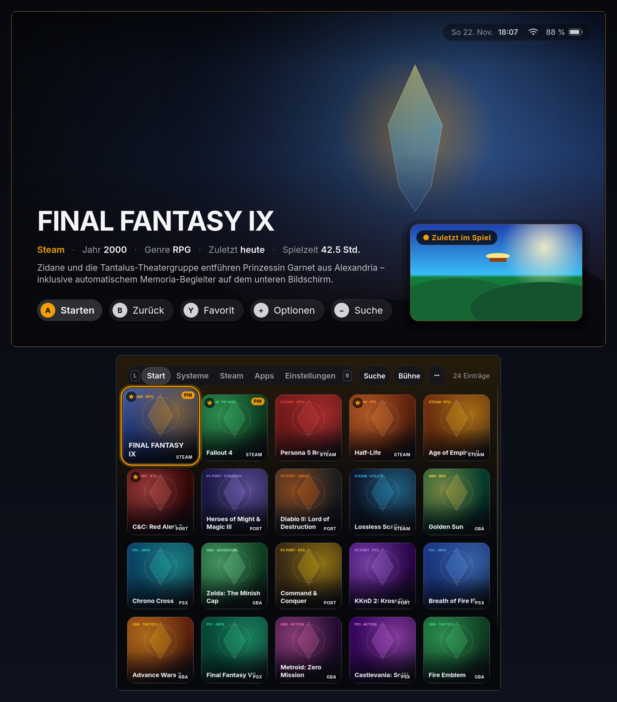
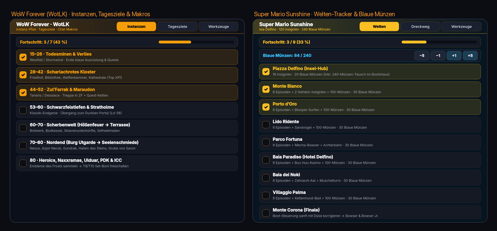

# Toravo Tandem

Dual-screen game launcher for ArmadaOS on the AYN Thor: the game on the top screen, controls and per-game companion
screens on the bottom one. A lean native program (Python + Qt), no browser, Steam stays out of sight.

## Installation (2 easy ways)

### Option 1 — Ready-to-Flash OS Image (No Terminal Needed · Based on ArmadaOS)
Download the complete, bootable **Toravo Tandem OS** image (based on ArmadaOS / Fedora 44 `bootc` with Toravo Tandem pre-installed):

- **Direct download (`.img.xz`, 5.2 GB):** [toravo-tandem-os-1.2.0-arm64.img.xz](https://toravo.de/_downloads/toravo-tandem-os-1.2.0-arm64.img.xz) ([SHA-256](https://toravo.de/_downloads/toravo-tandem-os-1.2.0-arm64.img.xz.sha256))
- **Why `.img.xz` instead of `.iso`?** The AYN Thor boots via **OpenABL (ARM64 UEFI)** directly from GPT disk images on microSD or USB drives rather than legacy x86 CD ISOs. Standard flashers (**Balena Etcher**, **Raspberry Pi Imager**, **Rufus**) write `.img.xz` directly without unpacking.
- **3 steps:**
  1. Flash `toravo-tandem-os-1.2.0-arm64.img.xz` onto a microSD card or USB drive (≥ 16 GB) using Balena Etcher, Raspberry Pi Imager, Rufus, or `sudo ./os/flash-thor.sh`.
  2. Insert into your AYN Thor and boot via OpenABL — it launches straight into **Toravo Tandem** and the first-run wizard (Wi-Fi, keyboard, game folders).
  3. Full upstream **ArmadaOS updates (`bootc upgrade`)** and **Toravo Tandem auto-updates** keep working normally. You can also build the image yourself with [`os/`](os/README.md).

### Option 2 — One-Line Install on Existing ArmadaOS
On the device (desktop mode › console, or over SSH):

    curl -L toravo.de/tandem | bash

(or `curl -L https://github.com/harmssi/thor-tandem/releases/latest/download/get.sh | bash`).

The interface speaks English or German (Settings › Look › Language; the installer follows your system language).

## New in 1.9.0 — Dual-Screen PokeDaisy Engine, BananaNative 12 GB Perf & Turnip v1.0.0

- **Native Dual-Screen PokeDaisy Engine & Bidirectional Save Bridge (`tandem.py`, `companion.py`, `saves.py`):**
  - Integrates **PokeDaisy (`v1.6.2.2-thor`)** as a first-class dual-screen engine for GB, GBC, GBA, and NDS Pokémon cartridges (auto-detected by ROM header, with 1-tap per-game override back to RetroArch/melonDS) plus a standalone **PokeDaisy** app entry (Library, Save Editor & Trade view):
    - **Top OLED (`:0`, `1920×1080` @ 120 Hz):** Uninterrupted 16:9 `EXPAND` widescreen gameplay (`6×`/`7×` integer scale), Field HUD, sub-millisecond `nanosleep` frame pacing, and `L3` Quick Ring Menu (`PC Anywhere`, `Fly` / Free Flight, `Repel`, `Bike`, `Wild Encounters`, `Save/Load State`, `Fast-Forward`).
    - **Bottom OLED (`:1`, `1240×1080` Touchscreen):** Always-on live German Touch Companion (`413×360` → crisp `3×` integer scale: `TEAM`, `DEX`, `KARTE` with direct touch-Fly, `BEUTEL`, `GUIDE`, and automatic `BATTLE` coach on battle entry) via zero-copy `/dev/shm` shared memory without ever pausing or minimizing the top screen.
  - **Lossless Bidirectional Save Sync:** Automatically seeds and syncs `.sav` / `.srm` battery saves between PokeDaisy (`~/.local/share/pokedaisy/saves/`), RetroArch, melonDS, and Tandem's rolling SD/SSH save backup system (with conflict backups in `pokedaisy-backups/`).
- **BananaNative / Ocarina of Time 12 GB Thor Tuning (`thor_perf.py`, `tandem.py`):**
  - 4-tier SM8550 CPU core isolation (`vk-replay` on Prime Core 7, dedicated background PSO compiler cores), incremental push descriptors, async mesh/effect compute PSOs with 12 ms setup guard, `MALLOC_ARENA_MAX=2` glibc arena cap, LSFG dip resilience, and PSI exposure-target protection.
- **Turnip `v1.0.0` Linux Bundle Filter & macOS/Test Audio Guard (`thor_updater.py`, `telemetry.py`):**
  - Skips Android-only `-Emu-` archives on `Droid-Deck/Drivers` releases so `DD-Turnip-v1.0.0` installs cleanly on ArmadaOS, and strictly blocks local BGM/UI audio playback during headless offscreen unit tests and on macOS.

Earlier in 1.8.0 — iiSU × Cocoon Unified Square Visual Edition (`0 MB` Extra Bloat · Pure Native `QPainter`):

- **Unified `1:1` Square Cocoon × iiSU Tile Grid Across All Tabs & Zoom Levels (`ui/tandem_ui.py`, `ui/iisu_fx.py`):**
  - Strictly symmetrical **`1:1` square squircle tiles** across `Start`, `Systems`, `Steam`, `Apps`, and every console view at all zoom levels (`3 · 4 · 5 · 6` columns), featuring full-bleed cover framing (zero blurred sidebars), native Cocoon platform frames/badges, and luminous two-tone platform-hue gradient rims.
- **Cohesive Full-Width Glass Console Menu Bar & Symmetrical Top Header (`ui/iisu_fx.py`, `ui/tandem_ui.py`):**
  - Bottom screen features a single edge-aligned **Liquid-Glass Console Dock** (`L · Tabs · R` + authored SVG action capsule for Search, View Mode, Grid Zoom, Random & Options) aligned pixel-for-pixel with the square tile grid, mirrored by a matching **Top-Screen Channel & Status Header** on the exact same horizontal axis.
- **iiSU-Style Floating 3D Retail Cases + Cartridge / Optical Disc Pop-Out (`ui/iisu_fx.py`, `ui/tandem_ui.py`):**
  - Showcases every game on the top 120 Hz AMOLED in its **authentic 3D retail packaging** (crimson Switch case, GBA/SNES box, PS1 jewel case, PS2/GC keep-case) with sculpted spine bevel, smooth radial shadow, diagonal Aero glass sheen, Living-Moment PIP, and an **animated Game Cartridge / Switch Card / Iridescent Optical Disc** sliding out from behind the case.
- **Dual-Screen "Hinge-Bridge" Aurora Continuity & 2 Flagship Themes (`ui/themes/iisu-aero.json`, `ui/themes/iisu-pearl.json`):**
  - Twin two-tone aurora plumes derived from the selected game's cover flow seamlessly across the physical clamshell hinge (`:0` ↔ `:1`), paired with **`iiSU Aero OLED`** (true AMOLED deep ink `#04060c` + sky-cyan glass) and **`iiSU Pearl`** (daylight porcelain & frosted pearl cards), bouncy spring physics (`0 %` CPU at rest), optional Cocoon Bento Pods, authored vector console silhouettes, and a **360 ms Console Launch Ceremony** (`0 ms` added launch wait).
- **100 % Emulator-Free Switch Pipeline — Autonomous Native Conversion (`companion.py`, `tandem.py`):**
  - Retires legacy Switch emulation (`Eden`) completely in favour of **Peanuts Native `0.1.8-1`** (`nxhost_generic` Universal Runtime-Profile Host + 77+ profiles + automatic provisional profiling) and **BananaNative `0.3.53-preview`**; automatically deduplicates Switch titles and converts any newly added `.nsp` / `.xci` / `.nsz` in `ROMs/switch` into a native ARM64 + Vulkan AOT game in the background while idle.

Earlier in 1.7.0 — Silent 0-RPM & Max Battery Endurance Suite (`0 MB` Extra RAM):

- **True `0 dB / 0 RPM` Semi-Passive Fan Curves & Smooth Hysteresis (`os/power-profiles.conf`, `thor.py`, `thor_perf.py`):**
  - Cuts fan power completely (`pwm1_enable=3`, **`0 RPM`**) below `52–56 °C` across menu, Standby, 2D/retro games & guides, with `3×` gentler ramp-up (`12`) and thermal-mass smoothing (`0.72`) so brief loading spikes never trigger fan noise, plus a dedicated **`0 dB`** quick-toggle in Quick Menu & Settings.
- **Automatic Per-Console Smart Auto-Eco (`thor_perf.py`, `tandem.py`):**
  - Automatically runs 2D & classic systems (`GB/GBA/SNES/MD/NES/PS1/NDS/PICO-8`) on `Eco` + `60 Hz` (`~3.5–5 W`, **6–8+ hrs battery, `0 RPM` silent**) and 6th-gen 3D (`PS2/GameCube/Wii/N64/PSP/Dreamcast`) on SM8550 sweet-spot `Balanced` (`schedutil`, released `220 MHz` idle GPU floor).
- **🍃 Whisper Mode — Vulkan `FIFO` Frame-Pacing & `40 FPS @ 120 Hz` Golden Mode (`thor_perf.py`, `ui/quick_view.py`):**
  - Forces `MESA_VK_WSI_PRESENT_MODE=fifo` + `DXVK_FRAME_RATE` so FEX-Emu & Wine threads sleep cleanly on VSync instead of busy-spinning in `MAILBOX`, paired with an exact 3-refresh **`40 FPS` cap on the 120 Hz OLED** (saves **30–40 % watts & heat** with smooth 25 ms frame pacing).
- **Dynamic Wi-Fi 7 (`ath12k`) + PCIe Runtime Power-Save & 1-Tap `✈️ Airplane Mode` (`telemetry.py`, `os/99-toravo-hw.rules`):**
  - Enables IEEE 802.11 power-save + PCIe Runtime-PM (`auto`) in menus, Standby & offline games (~1–1.5 W saved), automatically pausing it during Moonlight, AirPlay, Pro-Controller or Netplay (`0 ms` streaming lag), plus 1-tap **`✈️ Airplane`** in Quick Menu.
- **Deep Standby Clamping, Gyro Auto-Sleep (`-27 %` Idle CPU), `🌑 Bottom Off` & Audio Codec Sleep (`tandem.py`, `thor.py`):**
  - Clamps all SM8550 clusters to `307/499/595 MHz` + `220 MHz` GPU in Standby (`org.armada.Power1.Suspend`), silences idle Qualcomm IMU/InputPlumber polling, adds 1-tap **`🌑 Bottom off`** (`GAMESCOPE_COMPANION_LOCKED` DRM sleep + auto-idle dim), `3 s` WirePlumber audio-amp sleep (`52-tandem-power-save.conf`), `< 25 %` Stick-LED saver, and optional **Backpack Guard** auto-poweroff in battery Standby (`0.0 W`).

Earlier in 1.6.0 — Zero-Idle-RAM Suite: AirPlay, ROM Patcher, CHD/RVZ Shrinker, Cloud-Saves, Trophy Banners, Offline Whisper & Mac/PC Pro-Pad:

Engineered with a strict **0.0 MB background RAM budget** during gameplay (`mem_available_gib()` RAM guard + ephemeral one-shot workers):

- **Apple AirPlay Receiver on Bottom or Top OLED (`thor_pro.py`, `ui/quick_view.py`):**
  - Stream your iPhone, iPad, or Mac via **`📱 AirPlay`** directly onto the **bottom OLED** while your game keeps running at full FPS on top — or fullscreen on the top 120 Hz OLED (`Apps › AirPlay`). Starts `uxplay` strictly on demand and terminates by exact PID on exit (`0 MB` idle RAM).
- **On-Device Non-Destructive ROM Patcher (`thor_pro.py`, `ui/tandem_ui.py`):**
  - Built-in pure-Python **`.ips` / `.bps` / `.ups`** + **`xdelta3`** patcher right inside every retro game's `+` Options menu (`🧩 Apply ROM patch`) and drag-&-drop web uploader — creates a separate `[Patch]` game tile while keeping your original ROM 100 % untouched.
- **Lossless `CHD` & `RVZ` Disc Shrinker (`thor_pro.py`, `ui/settings_view.py`):**
  - Converts `.bin/.cue`, `.gdi`, `.iso`, and `.gcm` discs (PS1, PS2, PSP, Dreamcast, Saturn, GameCube, Wii) into verified lossless **`.chd` / `.rvz`** (`Settings › Library › Shrink games`), saving **40–65 % storage** (runs strictly outside gameplay on 2 Silver threads).
- **Zero-Daemon Bidirectional Cloud-Saves (`saves.py`, `tandem.py`):**
  - Sub-second pre-launch timestamp sync against your SSH/NAS target before a game starts (with automatic local conflict backups in `cloud-conflict-bak/`) — `0 MB` background RAM while playing.
- **PS5/Xbox-Style Trophy Popup Banners & Pinned Target Achievements (`thor_pro.py`, `ui/tandem_ui.py`):**
  - Animated gold **`🏆 TROPHY UNLOCKED`** banner with synthesized chime & dual LRA haptic pulse on the bottom OLED (never covering the top screen), plus tappable **`📌 Target`** pins for up to 3 open achievements per game.
- **Ephemeral Offline Voice Notes & Voice Guide Search (`thor_pro.py`, `ui/decks/universal.py`):**
  - Tap **`🎙️ Dictate`** in Notes or **`🎙️ Ask`** in Guides: records a short clip from the built-in mic and runs a one-shot Silver-core `faster-whisper` (`int8` CTranslate2, 0 € cloud) subprocess that inserts the German transcription or opens the matching guide passage and **immediately frees 100 % of its RAM**.
- **Wireless "Thor as Pro-Controller + Touch-Deck" for Mac & Gaming-PC (`thor_pro.py`, `ui/decks/propad.py`):**
  - Turns the AYN Thor into a 120 Hz Hall-effect wireless controller + multi-touch trackpad + desktop macro deck over Wi-Fi UDP (`8389`), with a 1-command Mac/PC receiver served directly at `http://<thor>:8378/thor-pad.py`.

Earlier in 1.5.0 — Native AirPods AAP, 30s RAM Replay, Stream-Deck Macros, Cheats, Deep-Freeze & Heroic Bridge:

- **Native Apple AirPods Support via AAP L2CAP `0x1001` & Gaming BT Audio Pro (`thor_airpods.py`, `ui/quick_view.py`, `ui/settings_view.py`, `ui/tandem_ui.py`):**
  - Direct pure-Python Bluetooth L2CAP `SOCK_SEQPACKET` (`PSM 0x1001`) Apple Accessory Protocol client — no iPhone/Mac required!
  - Live **Left · Right · Charging Case** battery readout (plus `🎧 %` in the top OLED status bar), 1-tap **Noise Control (`Off · ANC · Transparency · Adaptive`)** synced bidirectionally with AirPods stem squeezes, **Conversational Awareness**, automatic **In-Ear Detection** pause/resume, 1-tap Quick Connect in the Thor Quick Menu, and a **WirePlumber Gaming Low-Latency profile** (`SBC-XQ`, full-bitrate `AAC`, `10.6 ms` quantum, and zero 8 kHz HSP handsfree audio drop in games).
- **30-Second RAM Instant-Replay ("Switch Clip") + QR Phone Share (`thor_features.py`, `ui/quick_view.py`):**
  - Rolling `6 × 6 s` H.264 ring buffer in tmpfs RAM (`/run/user/1000/tandem-replay`, **0 % UFS 4.0 flash wear**, pinned to Silver cores `0–2`). Tap **`⏪ 30s-Clip`** in Quick Menu to stitch the last 30 seconds losslessly (`-c copy`) and scan the instant **LAN QR Code** to save the MP4 clip straight to your phone.
- **Programmable 3×4 "Thor Stream-Deck" Macro Pad & Live Cheat Switches (`thor_features.py`, `ui/decks/universal.py`):**
  - Switch the Universal Controls tab between **`🎮 Controls`**, **`🎛️ Macro Pad`** (customizable 12-tile touch Stream Deck with `PC-RPG`, `Strategy`, and `Retro-Pro` presets, key combos, sequences & **12 Hz Turbo-Fire**), and **`🕹️ Cheats`** (live Libretro `.cht` 60-FPS / Widescreen / Trainer switches with 1-tap online `libretro-database` download).
- **True `0 W` Deep-Freeze, `< 5 %` Battery Guard, HLTB `< 5h` Filter, Couch-Coop Netplay & Heroic GOG/Epic Bridge (`thor_features.py`, `tandem.py`):**
  - **`❄️ Freeze` (`0 W`):** Freezes unpausable cutscenes & Souls/PC games in place (`SIGSTOP`/`SIGCONT`), plus automatic `< 5 %` critical-battery state-save & freeze protection.
  - **HowLongToBeat / SteamSpy Progress & `Short (<5h)` Filter**, automatic **TV Dock Bluetooth Pad → Player 1** swap + **1-Tap RetroArch LAN Netplay**, and automatic discovery of installed **GOG / Epic / Amazon** games from Heroic Games Launcher with full `HyperDrive` & `Proton-CachyOS ARM64EC` acceleration.

Earlier in 1.4.0 — Manuals Reader, Bifrost LEDs, ProtonDB & Storage Cleaner:

- **Native Dual-Screen PDF & CBZ Game Manual Reader (`companion.py`, `ui/decks/universal.py`, `tandem.py`):**
  - Open original game booklets, strategy guides, and comic manuals (`.pdf`, `.cbz`) directly on the bottom OLED screen while your game keeps running on top — rendered natively in memory via `PySide6.QtPdf.QPdfDocument` (`pdftoppm` fallback) with instant `◀ / ▶ / +5` page turning, `1:1 / + / −` pinch/tap zoom, finger pan, per-game page bookmarks, and automatic discovery of `ES-DE/downloaded_media/<system>/manuals/*.pdf` & `ROMs/<system>/manuals/*.pdf`.
- **ProtonDB Compatibility Badges & On-Device Cover/Hero Picker (`companion.py`, `ui/tandem_ui.py`):**
  - Displays cached **ProtonDB Tier Badges** (`Platinum · Gold · Silver · Bronze`) directly on the top OLED info bar for installed Steam games, plus a built-in **`🎨 Choose cover & art`** gallery inside every game's `+` Options menu to browse and apply alternative Steam / Libretro Boxart / Title-Screen covers & hero banners (or restore defaults) right on the Thor.
- **"Thor Bifrost" Smart Stick-LED Modes (`telemetry.py`, `tandem.py`, `ui/settings_view.py`, `ui/quick_view.py`):**
  - Five intelligent lighting modes for the analog-stick RGB rings (`Settings › Lighting` & Quick Menu): **Game colour** (cover accent), **Ambilight** (live gameplay screen color sampling while playing), **Battery** (traffic-light charge indicator + Cyan pulse during USB-PD/PPS fast charging), **Temp** (cool blue -> amber -> red thermal guardian above 65 °C), and **Static**.
- **Safe Storage Cleaner (`thor_storage.py`, `ui/settings_view.py`):**
  - Built-in **`Storage cleanup` (`Speicher-Bereinigung`)** analyzer & 1-tap cleaner under `Settings › Library` that reclaims gigabytes from orphaned Steam `compatdata` prefixes of uninstalled games, stale `shadercache` folders, and Trash/temp leftovers while strictly protecting all installed Steam manifests, non-Steam `shortcuts.vdf` entries, Proton/SLR runtimes, and savegames.

Earlier in 1.3.0 — Live Screen Game Translator (PlayTranslate Style · Offline & Hybrid):

- **Real-Time Dual-Screen Game Translator (`thor_translate.py`, `thor_ocr_worker.py`, `ui/decks/translator.py`):**
  - Built-in **`Translate` (`Übersetzen`)** tab in the Universal Companion Deck, every bespoke game companion (`Tools`), and Dual-Screen decks, plus a 1-tap **`🌐 Translate`** button in the Thor Quick Menu.
  - **1-Tap & Auto-Dialogue Mode:** Captures the top OLED game screen (`:0`) and translates English, Japanese, Chinese, Spanish & French dialogue into **German** on the bottom OLED screen, with a lightweight pixel-fingerprint + typewriter-settle detector that automatically updates whenever a new dialogue box appears.
  - **Finger-Drawn Dialogue Regions:** Choose `Full screen`, `Bottom dialogue`, `Top dialogue`, or drag your finger directly over a live preview of the top screen to frame the exact subtitle/speech box (saved per game).
  - **Zero-Cost Offline + Hybrid Engine (0 % Game FPS Loss):** Persistent `PaddleOCR` (`rapidocr-onnxruntime`) + `CTranslate2` int8 Marian-NMT worker pinned to **Silver Cortex-A510 cores (`CPU 0–2`)** (~220 MB, zero PyTorch/CUDA bloat, 100 % offline capable on a plane), with tappable **Word-Lookup chips**, phonetic Romaji/Pinyin reading hints, **30-line Dialogue History**, and **German Text-to-Speech (`🔊`)**.

Earlier in 1.2.0 — Zero-Lag, Audio-DSP & UFS 4.0 Edition:

- **PipeWire "Thor Audio-DSP" Psychoacoustic Speaker Pipeline (`telemetry.py`, `ui/quick_view.py`, `ui/settings_view.py`):**
  - Zero-glitch `libpipewire-module-filter-chain` DSP (`Off · Cinema Bass · Clear · Night`) targeting **exclusively** the internal stereo speakers (`alsa_output.platform-sound.HiFi__Speaker__sink`) while keeping wired headphones and Bluetooth audio 100 % bit-perfect. Cuts sub-105 Hz cone excursion while boosting 168 Hz upper-bass warmth and 5.2 kHz stereo air — inspired by the Steam Deck OLED & Asahi Bankstown pipelines.
- **RetroArch "Zero-Lag" (~55 ms Faster), Instant Auto-Resume & Built-In Offline OLED Shaders (`companion.py`, `tandem.py`):**
  - Automatically tunes RetroArch for `video_max_swapchain_images = "2"`, `28 ms` PipeWire audio, `video_frame_delay_auto = "true"`, and `1 Preemptive Frame` across 25+ classic 2D consoles (kept off for 3D cores so N64/PS1 never stutter).
  - Ships two self-contained `#version 450` Vulkan Slang shaders (**`CRT-OLED`** Trinitron scanlines + aperture grille & **`Handheld-LCD`** subpixel cell grid + warm GBA/GBC color matrix) with `Auto` per-system selection and 1-tap override in Quick Menu Pro, plus OnionOS-style **Instant Auto-Save / Auto-Resume**.
- **OnionOS-Style Visual Game Switcher & Native ArmadaOS Dual-Screen Capture (`ui/quick_view.py`, `companion.py`, `tandem.py`):**
  - Upgraded `Quick Switch · Recent Games` into full-bleed gameplay moment cards (`● Live frame` + playtime + 1-tap switch even while another game is running), and added native ArmadaOS `x11grab` capture fallback so both `MomentTracker` and dual-screen `Screenshot` (`-oben.png` + `-unten.png`) work without `gamescopectl`.
- **UFS 4.0 Lockless I/O, MGLRU 500 ms Thrash Guard & 8 GB Shader/DXVK Vault (`os/99-toravo-*`, `thor_perf.py`):**
  - Switches internal 4.2 GB/s UFS 4.0 flash (`sd[a-z]`) from single-lock `bfq` to lockless `none` (`read_ahead_kb=256`, keeping `bfq` on microSD), enables Multi-Gen LRU working-set protection (`min_ttl_ms=500`), disables background memory compaction stalls (`vm.compaction_proactiveness=0`, THP `defer+madvise`, `kernel.timer_migration=0`), sets `8 MB` streaming socket buffers + `hwdec=auto-safe` Qualcomm Iris V4L2 video decode for `mpv`, and adds `DM_VK_MESH=0` stability protection against Adreno 740 `VK_EXT_mesh_shader` UCHE faults.

Earlier in 1.1.0 — HyperDrive Ultra Edition:

- **1-Click Mesa-Git Turnip Driver Updater (`thor_updater.py`, `ui/settings_view.py`, `thor_perf.py`):**
  - Integrated upstream **Adreno 740 Linux ARM64 `glibc` Turnip feed** (`Droid-Deck/Drivers`, Wayland + X11 WSI) directly into `Settings › Updates › Emulators & Sources` and the full auto-updater, with dual SHA-256 verification, strict `ELF64 aarch64 glibc` validation (automatically rejects Android/Bionic `.so` builds), **1-Tap `.prev` Rollback**, and instant live selection in Quick Menu Pro & `Performance › Turnip`.
- **Zero-Config Per-Game Smart Presets (`thor_perf.py`, `tandem.py`):**
  - Automatically applies optimal `720p SGSR` Super-Resolution + `Performance` profiles for demanding DX11/DX12/UE4/UE5 Steam titles and automatic `Strict TSO` for sensitive Unity engines whenever no manual per-game override is set.
- **Native Runtime RAM-Pinning, 4-Core PSO & Cortex-X3 Replay Thread Affinity (`thor_perf.py`):**
  - On 12 GB+ Thors with ZRAM swap, automatically disables legacy storage-backed texture/shader eviction (`DM_MEM_FILEBACK=0`, eliminating per-frame major page faults while >7 GiB RAM is free), parallelizes background Vulkan shader compilation across 4 threads (`DM_VK_PSO_SLOTS=4`), and pins the critical `vk-replay` thread directly to the 2.96 GHz Cortex-X3 Prime core (`DM_VK_AFF_REPLAY=0x80`).
- **ARM64 Syscall Overhead Reduction (`os/patch-armada-img.sh`):**
  - Appends `mitigations=off` to kernel boot options, removing ARM64 Spectre-v2/BHB loop overhead across high-frequency `ntsync`/`fsync`, FEX `mtrack`, and Vulkan `VM_BIND` syscalls.

Earlier in 1.0.0 — HyperDrive Edition:

Engineered from bare-metal profiling on the **AYN Thor (Snapdragon 8 Gen 2 / Adreno 740)** to beat Android in input latency (~20–35 ms faster), available game memory (~8.7 GiB free on a 12 GB Thor), 1%-low frame pacing, and DirectX 11 draw-call throughput:

- **1-Tap `⚡ HyperDrive` Switch (`thor.py`, `thor_perf.py`, `ui/quick_view.py`, `ui/settings_view.py`):**
  - **Turnip Driver Switcher:** Live global & per-game switching between **Turnip WinNative 27.0-devel** (custom-tuned for Windows ARM64EC DX11/DX12), **Devel 27.0**, **Stable 26.2**, and user Turnip packages, paired with direct `VK_DRIVER_FILES` isolation that strips `llvmpipe` / `libLLVM` (~120 MB RSS) out of every game process.
  - **FEX Fast-JIT (`TSO=0`) + ARM64EC Proton-CachyOS 11.0:** Disables expensive software TSO atomic barriers on Snapdragon 8 Gen 2 (`Multiblock=1`, `X87ReducedPrecision=1`, `TSOEnabled=0` → +35–50 % CPU-bound DX11 FPS), auto-wires `armada-game-launch` + `proton-cachyos-11.0-arm64` across all installed Steam games, PC ports & 3D emulators, and adds a per-game `Strict TSO (Crash-Fix)` toggle.
  - **SteamOS `scx_lavd` Kernel BPF Scheduler:** Live zero-root switching between **LAVD 1.1.3** (Valve/CachyOS Latency-Aware Virtual Deadline gaming scheduler), **Cosmos** (big.LITTLE), and **EEVDF**.
  - **Asymmetric Dual-Screen Core Isolation:** Reserves **Gold + Prime Cortex-X3 cores (`CPU 3–7`, `nice -10`, `5:3,4,5,6,7` Wine topology)** exclusively for the running game while pinning Tandem & the bottom-screen Companion UI to **Silver Cortex-A510 cores (`CPU 0–2`)** — **0 % CPU tax** from the second screen, eliminating 5.5×–8.3× Silver-core thread stalls.
- **Hardware Performance & Thermal Engine (`thor_perf.py`, `os/99-toravo-perf.conf`, `os/99-toravo-hw.rules`):**
  - **4 Hardware Profiles:** `Eco`, upgraded `Balanced` (`schedutil` instead of sluggish `conservative`), `Performance` (full `2.02 / 2.80 / 2.96 GHz` + `300 MHz` UFS 4.0 flash clock), and **`Turbo`** (locks all CPU clusters to max + **Adreno 740 locked at `680 MHz`**).
  - **Quick Menu Pro (Thor Hardware Key):** Live CPU GHz, GPU MHz, free RAM GiB & active BPF scheduler in the header; direct controls for **HyperDrive**, **Turnip driver**, **Adreno GPU clock (`Auto / 401 / 550 / 680 MHz`)**, **Smart Fan (`Auto / Quiet / Cool / Max`)**, and **1-Tap Super-Resolution (`1080p Native / 900p SGSR / 720p Boost`)** (+45–85 % fill-rate FPS in GPU-bound 3D games).
  - **Real Gamescope X11 Hardware Pipeline:** Native `GAMESCOPE_LOW_LATENCY=1` + 2-frame Vulkan WSI + 24 ms PipeWire audio, hardware **OLED Color Vibrance** (`sRGB / Natural / Vibrant / Ultra` via `GAMESCOPE_COLOR_SDR_GAMUT_WIDENESS`), hardware 3D-LUT Night Mode (`GAMESCOPE_COLOR_LOOK_G22`), hardware FSR/SGSR upscaling, and `lz4` ZRAM in the OS image.
- **Showcase UX & Console Feel (`ui/tandem_ui.py`, `ui/themes/*.json`):**
  - **Ambient Stick-RGB (`rgb_sync`):** Physical analog-stick LED rings smoothly morph to match the dominant cover color of the selected or running game.
  - **11 Curated OLED Themes:** Added **Cyber Neon**, **Synthwave**, **Nord Frost**, **Crimson Ember**, **Emerald OLED** (true `#000000`), and **Midnight Gold**.
  - **Tactile Console Haptics (`ui_haptics`):** Crisp 12 ms Qualcomm `qcom-hv-haptics` LRA clicks across menu navigation, tabs, Quick Menu toggles & game launches, plus a 1-tap **Random Game (`Zufall`)** picker, ambient top-screen accent glow, and glass-sheen Stage cards.

Earlier in 0.6.0:

- **Automatic Game Companion Installer (`thor_updater.py`, `companion.py`, `tandem.py`):**
  - Automatically scans your installed Steam, Game Boy / GBA, Dual-Screen and PC Port libraries and installs or updates matching bottom-screen companions with zero manual setup.
  - **Steam Companion Plugins:** Automatically provisions & updates *FINAL FANTASY IX* (`Memoria` companion DLL + `[ThorStatus]`), *Fallout 4* (*Thor Pip-Boy* `v0.2.0` F4SE plugin + quick-keys config), and *Persona 5 Royal* Steam (`steam_api64.dll`), verified against `SHA256SUMS` with automatic `.thor-bak` / `.prev` backups.
  - **GB / GBC / GBA Companion Shelf (GBADuo v1.0.1):** Multi-region (`DE` / `EU` / `US` / `JP` 3-letter stem) and ROM-hack matching across 32+ interactive companion packs, plus automatic RetroArch local UDP memory bridge (`55355`) activation.
- **Integrated Update Service – Beyond Obtainium (`thor_updater.py`, `ui/settings_view.py`, `remote.html`):**
  - Pre-configured upstream GitHub & Forgejo ARM64 AppImage feeds (`DuckStation`, `ARMSX2`, `Azahar Enhanced`, `melonDS`, `Cemu`, `Eden`, `RPCS3`, `Vita3K`, `xemu`) plus **custom GitHub repository feeds** (`+ Add custom GitHub source` in `owner/repo` format – no manual asset regex required).
  - Compares real on-disk SHA-256 digests against upstream release digests (detects rolling updates without redundant re-downloads), verifies ELF binaries & checksums, keeps **1-Tap Rollback** (`.prev`) backups, preserves your unified controller bindings across updates, updates Flatpak emulators, and auto-installs missing Libretro ARM64 cores for owned ROM folders while idle.
- **Integrated Linux & Tandem System Backup + Live UFS Dual-Boot Storage Split (`thor_storage.py`):**
  - Multi-threaded `zstd` (`.tar.zst`) `System Profile` and `Full Home` backups to microSD + optional SSH server with 1-tap restore.
  - Live retroactive Android `userdata` shrinker on the AYN Thor's UFS 4.0 drive (down to `8 GiB`), reclaiming up to `+105 GiB` online into Linux `/var/home` via Btrfs multi-device expansion without reinstalling ArmadaOS.
- **Touchscreen 2.0, Smart Gameplay Scene Previews & 60-FPS Sprite-Cached OLED Screensaver (`ui/tandem_ui.py`, `ui/screensaver.py`):**
  - 120 Hz kinetic flick scrolling with fast-scrub scrollbar, 1:1 Stage carousel finger drag, 420 ms tile long-press context menu, left-edge swipe-back, top-bezel swipe-down Quick Menu, and interactive top-screen button pills.
  - Menu-free **Last in-game** (`Zuletzt im Spiel`) scene card on the top screen (automatically filters out static save/title menus), installed-only Steam library filtering, and a pre-baked sprite-cached **60-FPS 28-cover `Thor Cosmos` OLED screensaver** (`< 2 ms` CPU/frame) with an orange-framed `Toravo Tandem` clock badge.
- **On-The-Go Battery Saver & USB-PD / PPS Fast-Charge Diagnostics (`telemetry.py`, `thor.py`, `ui/quick_view.py`, `ui/settings_view.py`):**
  - 1-tap **On-The-Go Mode** (`Unterwegs-Modus`, optionally auto-triggered on battery): switches to `Eco`, drops the top OLED refresh rate from `120 Hz` to `60 Hz`, turns off stick RGB LEDs, gently caps brightness, and stops idle background Steam.
  - Live **USB-PD / PPS Fast-Charge Negotiation** readout (`9 V / PPS 27W+` vs `5 V SDP PC data port`, negotiated `V · A`, PMIC cell current ceiling, and native `s2idle` deep-sleep verification).
- **Native AI Coding Agents on the Thor (`tandem.py`, `ui/tandem_ui.py`):**
  - Direct top-screen launchers for **Claude Code** and **Google Antigravity (`agy`)** in autonomous `--dangerously-skip-permissions` mode, paired with a dedicated bottom-screen AI quick-action bar (`Claude ⚡`, `agy ⚡`, `⇧Tab`, `/compact`, `Ctrl+C`, `Esc`, `Send ↵`) above the haptic keyboard.

### Real AYN Thor Dual-Screen UI, Quick Menu & Companions

### Integrated Update Center, 60-FPS OLED Screensaver & Live Storage Split

Earlier in 0.5.0:
- **Dual-Screen OLED Screensaver with Original Box Art (`ui/screensaver.py`, `tandem.py`):** Seamless wall-clock-synchronized showcase across both OLED screens on pure `#000000` black with zero stationary pixels – **Thor Cosmos** floats authentic original retail game boxes (SNES/N64 horizontal cardboard boxes, GB/GBA/PS1/DS square cases, GameCube/PS2/Wii/Switch keep-cases fetched automatically from `libretro-thumbnails` & `GameTDB`) across the hinge from top to bottom screen, alongside **Arcade Showcase**, **Dual Aurora** and **Minimal OLED Clock**.
- **Switch-2-Inspired Features (`ui/decks/universal.py`, `telemetry.py`, `ui/tandem_ui.py`, `remote.html`):**
  - *Mouse Mode in Every Game:* New `Mouse` (`Maus`) tab in the Universal Companion Deck turns the bottom touch screen into a precision `/dev/uinput` trackpad with scroll strip, left/right click and drag-lock.
  - *Pinned Virtual Game Cards:* Pin favourite titles to the front of the `Home` tab (`Start` menu › `Pin to Home`).
  - *Battery Care & Health:* Optional charge alerts at `80 %` or `90 %`, plus live battery health (`%`) and cycle count.
  - *Find My Thor & Console Sounds:* Trigger an ascending locator chime + 4 LRA vibration pulses from the web dashboard, and toggle optional subtle in-memory synthesized UI sounds.
- **Native Switch Runtime & On-Device Converter (`companion.py`, `saves.py`):** Automatic discovery and savegame backup for **Peanuts Native** and **BananaNative** packs (`Games/PeanutsNative`, `Games/BananaNative`), wireless Switch update/DLC `.nsp` upload, and background on-device conversion status in settings and `remote.html`.

Earlier in 0.4.0:
- **Redesigned Thor-Key Quick Menu & Live FPS Overlay (`ui/quick_view.py`, `telemetry.py`):** Bento command center on the Thor button with live battery wattage & remaining playtime, instant top-screen MangoHud FPS/frametime overlay toggle (`Off · FPS · Bar · Graph`), and a 1-tap Fast Game Switcher for recent titles.
- **Unified Gamepad Layout Across All Platforms (`controls.py`):** One consistent face-button layout across every console and emulator – default `Thor print` (`Right A = Confirm`, `Bottom B = Back` everywhere including PlayStation, PSP, Dreamcast/Flycast, Wii/Dolphin, Wii U/Cemu, GameCube, Switch, 3DS, DS and RetroArch) with a 1-click toggle to `Xbox style` (`Bottom = Confirm`, `Right = Back`).
- **Multi-View Web Dashboard & Playtime Analytics (`remote.html`):** Clean sidebar app dashboard on desktop and bottom-dock layout on mobile showing one focused area at a time, with 7-day playtime charts, most-played games, wireless Drag-&-Drop ROM/guide/pack uploads, and Time-Machine savegame restore.
- **55+ ES-DE systems & rich library metadata:** Super Famicom (`sfc`), Famicom/FDS, Neo Geo/CD, CPS-1/2/3, Naomi/Atomiswave, 32X, PC Engine CD, WonderSwan, Lynx, 3DO, Amiga, C64, DOS, ScummVM, PICO-8 and more; automatic `.m3u` multi-disc grouping; `gamelist.xml` descriptions, release year, genre, developer and time-to-beat; library sorting (`Recent`, `A–Z`, `Play time`, `Year`), custom collections, hidden games, and per-game emulator/core choice (`Start` or `⋯`).
- **Interactive Dual-Screen gameplay (`ui/decks/dualscreen.py`):** True two-screen configuration for Nintendo DS (`melonDS`), 3DS (`Azahar`) and Wii U (`Cemu`) with live secondary-window capture and real finger-touch forwarding from the bottom screen.
- **Universal In-Game Companion Deck (`ui/decks/universal.py`) for every game:**
  - *States:* Visual save-state cards with screenshot thumbnails and 1-tap slot save/load.
  - *Notes:* Finger-sketch pad (4 colours, dot grid, eraser, undo) + per-game checklists & text notes.
  - *Guides:* Zoomable/pannable map viewer, dark-mode walkthrough reader, and 1-tap offline Wikipedia overview fetcher.
  - *Music:* Background music player with independent PipeWire game-vs-music volume mixing.
  - *Cockpit:* Live battery wattage, calculated remaining playtime, CPU/RAM load, SoC temperature, fan RPM and sparklines.
- **PC-Streaming Deck (`ui/decks/pcstream.py`):** Precision multi-zone trackpad (tap-to-click, scroll strip, drag-lock), PC hotkeys (`Esc`, `Win`, `Alt+Tab`, `F11`, `Task-Mgr`), tactile 3D haptic keyboard toggle, and Wake-on-LAN.
- **Wireless File Drop, Savegame Time-Machine, Closed-Lid Music & Dock Mode:** Drag & drop ROMs, guides/maps or companion packs in the browser (`remote.html`); restore older save snapshots directly on the Thor; keep playing YouTube/Plex/music on headphones with the clamshell closed; auto-dim built-in OLEDs when docked to a USB-C TV/monitor.

Earlier in 0.3.0:
- Native YouTube and Plex dual-screen apps (`mpv` on top, touch/controller deck below) with QR-code phone sign-in (subscriptions, playlists, liked videos) and Wi-Fi offline downloads onto the SD card.
- Tactile 3D on-screen keyboard with AYN Thor LRA haptic click feedback, floating key magnifier, slide-to-correct, backspace hold-to-repeat, dedicated `@` key and reliable X11 `AltGr` character injection.
- Stage carousel view and Cocoon platform frames alongside the 5-column grid, plus night mode (warm / night blue-light filter).
- Per-game overrides in the quick menu (power mode, FPS cap, scaling filter), volume hold-to-repeat & mute, Captures gallery for screenshots and dual-screen recordings, Bluetooth audio & gamepad pairing, lid-close / charger-aware standby, and rolling SD + optional SSH savegame backups.
- BananaNative integration (smooth Vulkan/Vsync pacing, automatic bottom-screen recovery, save backups).

Earlier in 0.2.0:
- English interface.
- Quick menu on the Thor key, on the bottom screen: brightness of both screens, volume, power mode, stick lights, frame
  generation, recording, screenshot, back to Tandem, quit game.
- Recording of both screens with sound (into Videos/Tandem on the SD card).
- Frame generation switch for Lossless Scaling (needs your own Lossless Scaling copy and the lsfg-vk layer).
- WoW Forever signs in on its own (login kept on the device, like the Android launcher does it) and picks your game account.
- Native port decks for Half-Life, Age of Kings, Red Alert 2, C&C, Heroes III, KKnD 2 and Diablo II.

Everything else (features, setup, companion packs, wide view, themes) is in [tandem/README.md](tandem/README.md) (German).

Bring your own games. No game files, BIOS files or keys are part of this project.
`tandem/wide-core/` is derived from mGBA (MPL 2.0) and GBA Duo (GPLv3); see the README there.
