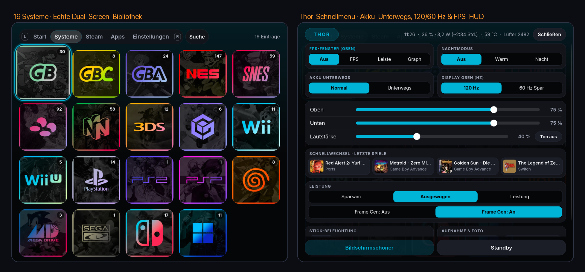
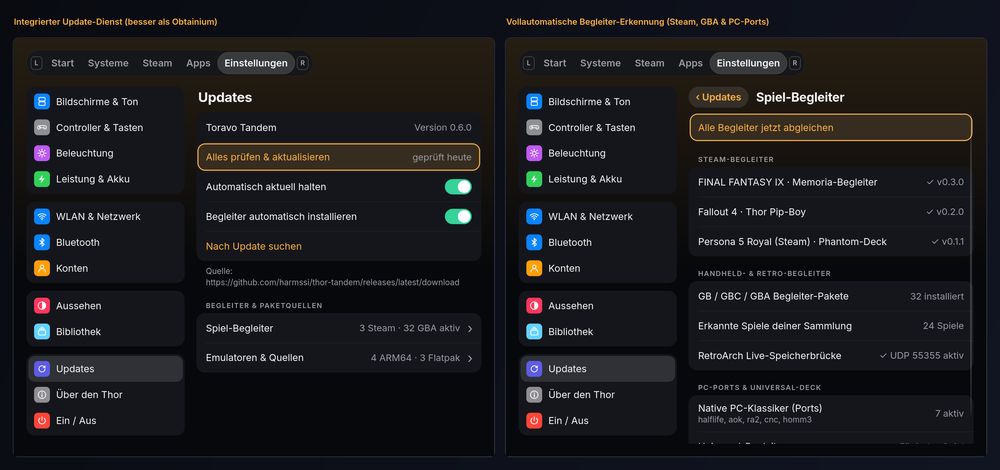
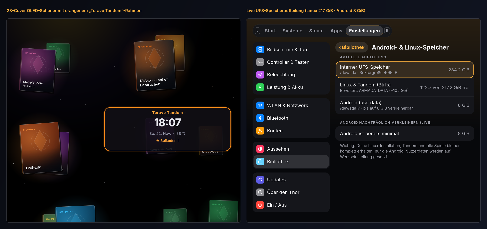

# Toravo Tandem

Dual-screen game launcher for ArmadaOS on the AYN Thor: the game on the top screen, controls and per-game companion
screens on the bottom one. A lean native program (Python + Qt), no browser, Steam stays out of sight.

## Installation (2 easy ways)

### Option 1 — Ready-to-Flash OS Image (No Terminal Needed · Based on ArmadaOS)
Download the complete, bootable **Toravo Tandem OS** image (based on ArmadaOS / Fedora 44 `bootc` with Toravo Tandem pre-installed):

- **Direct download (`.img.xz`, 5.2 GB):** [toravo-tandem-os-1.0.0-arm64.img.xz](https://toravo.de/_downloads/toravo-tandem-os-1.0.0-arm64.img.xz) ([SHA-256](https://toravo.de/_downloads/toravo-tandem-os-1.0.0-arm64.img.xz.sha256))
- **Why `.img.xz` instead of `.iso`?** The AYN Thor boots via **OpenABL (ARM64 UEFI)** directly from GPT disk images on microSD or USB drives rather than legacy x86 CD ISOs. Standard flashers (**Balena Etcher**, **Raspberry Pi Imager**, **Rufus**) write `.img.xz` directly without unpacking.
- **3 steps:**
  1. Flash `toravo-tandem-os-1.0.0-arm64.img.xz` onto a microSD card or USB drive (≥ 16 GB) using Balena Etcher, Raspberry Pi Imager, Rufus, or `sudo ./os/flash-thor.sh`.
  2. Insert into your AYN Thor and boot via OpenABL — it launches straight into **Toravo Tandem** and the first-run wizard (Wi-Fi, keyboard, game folders).
  3. Full upstream **ArmadaOS updates (`bootc upgrade`)** and **Toravo Tandem auto-updates** keep working normally. You can also build the image yourself with [`os/`](os/README.md).

### Option 2 — One-Line Install on Existing ArmadaOS
On the device (desktop mode › console, or over SSH):

    curl -L toravo.de/tandem | bash

(or `curl -L https://github.com/harmssi/thor-tandem/releases/latest/download/get.sh | bash`).

The interface speaks English or German (Settings › Look › Language; the installer follows your system language).

## New in 1.0.0 — HyperDrive Edition

Engineered from bare-metal profiling on the **AYN Thor (Snapdragon 8 Gen 2 / Adreno 740)** to beat Android in input latency (~20–35 ms faster), available game memory (~8.7 GiB free on a 12 GB Thor), 1%-low frame pacing, and DirectX 11 draw-call throughput:

- **1-Tap `⚡ HyperDrive` Switch (`thor.py`, `thor_perf.py`, `ui/quick_view.py`, `ui/settings_view.py`):**
  - **Turnip Driver Switcher:** Live global & per-game switching between **Turnip WinNative 27.0-devel** (custom-tuned for Windows ARM64EC DX11/DX12), **Devel 27.0**, **Stable 26.2**, and user Turnip packages, paired with direct `VK_DRIVER_FILES` isolation that strips `llvmpipe` / `libLLVM` (~120 MB RSS) out of every game process.
  - **FEX Fast-JIT (`TSO=0`) + ARM64EC Proton-CachyOS 11.0:** Disables expensive software TSO atomic barriers on Snapdragon 8 Gen 2 (`Multiblock=1`, `X87ReducedPrecision=1`, `TSOEnabled=0` → +35–50 % CPU-bound DX11 FPS), auto-wires `armada-game-launch` + `proton-cachyos-11.0-arm64` across all installed Steam games, PC ports & 3D emulators, and adds a per-game `Strict TSO (Crash-Fix)` toggle.
  - **SteamOS `scx_lavd` Kernel BPF Scheduler:** Live zero-root switching between **LAVD 1.1.3** (Valve/CachyOS Latency-Aware Virtual Deadline gaming scheduler), **Cosmos** (big.LITTLE), and **EEVDF**.
  - **Asymmetric Dual-Screen Core Isolation:** Reserves **Gold + Prime Cortex-X3 cores (`CPU 3–7`, `nice -10`, `5:3,4,5,6,7` Wine topology)** exclusively for the running game while pinning Tandem & the bottom-screen Companion UI to **Silver Cortex-A510 cores (`CPU 0–2`)** — **0 % CPU tax** from the second screen, eliminating 5.5×–8.3× Silver-core thread stalls.
- **Hardware Performance & Thermal Engine (`thor_perf.py`, `os/99-toravo-perf.conf`, `os/99-toravo-hw.rules`):**
  - **4 Hardware Profiles:** `Eco`, upgraded `Balanced` (`schedutil` instead of sluggish `conservative`), `Performance` (full `2.02 / 2.80 / 2.96 GHz` + `300 MHz` UFS 4.0 flash clock), and **`Turbo`** (locks all CPU clusters to max + **Adreno 740 locked at `680 MHz`**).
  - **Quick Menu Pro (Thor Hardware Key):** Live CPU GHz, GPU MHz, free RAM GiB & active BPF scheduler in the header; direct controls for **HyperDrive**, **Turnip driver**, **Adreno GPU clock (`Auto / 401 / 550 / 680 MHz`)**, **Smart Fan (`Auto / Quiet / Cool / Max`)**, and **1-Tap Super-Resolution (`1080p Native / 900p SGSR / 720p Boost`)** (+45–85 % fill-rate FPS in GPU-bound 3D games).
  - **Real Gamescope X11 Hardware Pipeline:** Native `GAMESCOPE_LOW_LATENCY=1` + 2-frame Vulkan WSI + 24 ms PipeWire audio, hardware **OLED Color Vibrance** (`sRGB / Natural / Vibrant / Ultra` via `GAMESCOPE_COLOR_SDR_GAMUT_WIDENESS`), hardware 3D-LUT Night Mode (`GAMESCOPE_COLOR_LOOK_G22`), hardware FSR/SGSR upscaling, and `lz4` ZRAM in the OS image.
- **Showcase UX & Console Feel (`ui/tandem_ui.py`, `ui/themes/*.json`):**
  - **Ambient Stick-RGB (`rgb_sync`):** Physical analog-stick LED rings smoothly morph to match the dominant cover color of the selected or running game.
  - **11 Curated OLED Themes:** Added **Cyber Neon**, **Synthwave**, **Nord Frost**, **Crimson Ember**, **Emerald OLED** (true `#000000`), and **Midnight Gold**.
  - **Tactile Console Haptics (`ui_haptics`):** Crisp 12 ms Qualcomm `qcom-hv-haptics` LRA clicks across menu navigation, tabs, Quick Menu toggles & game launches, plus a 1-tap **Random Game (`Zufall`)** picker, ambient top-screen accent glow, and glass-sheen Stage cards.

Earlier in 0.6.0:

- **Automatic Game Companion Installer (`thor_updater.py`, `companion.py`, `tandem.py`):**
  - Automatically scans your installed Steam, Game Boy / GBA, Dual-Screen and PC Port libraries and installs or updates matching bottom-screen companions with zero manual setup.
  - **Steam Companion Plugins:** Automatically provisions & updates *FINAL FANTASY IX* (`Memoria` companion DLL + `[ThorStatus]`), *Fallout 4* (*Thor Pip-Boy* `v0.2.0` F4SE plugin + quick-keys config), and *Persona 5 Royal* Steam (`steam_api64.dll`), verified against `SHA256SUMS` with automatic `.thor-bak` / `.prev` backups.
  - **GB / GBC / GBA Companion Shelf (GBADuo v1.0.1):** Multi-region (`DE` / `EU` / `US` / `JP` 3-letter stem) and ROM-hack matching across 32+ interactive companion packs, plus automatic RetroArch local UDP memory bridge (`55355`) activation.
- **Integrated Update Service – Beyond Obtainium (`thor_updater.py`, `ui/settings_view.py`, `remote.html`):**
  - Pre-configured upstream GitHub & Forgejo ARM64 AppImage feeds (`DuckStation`, `ARMSX2`, `Azahar Enhanced`, `melonDS`, `Cemu`, `Eden`, `RPCS3`, `Vita3K`, `xemu`) plus **custom GitHub repository feeds** (`+ Add custom GitHub source` in `owner/repo` format – no manual asset regex required).
  - Compares real on-disk SHA-256 digests against upstream release digests (detects rolling updates without redundant re-downloads), verifies ELF binaries & checksums, keeps **1-Tap Rollback** (`.prev`) backups, preserves your unified controller bindings across updates, updates Flatpak emulators, and auto-installs missing Libretro ARM64 cores for owned ROM folders while idle.
- **Integrated Linux & Tandem System Backup + Live UFS Dual-Boot Storage Split (`thor_storage.py`):**
  - Multi-threaded `zstd` (`.tar.zst`) `System Profile` and `Full Home` backups to microSD + optional SSH server with 1-tap restore.
  - Live retroactive Android `userdata` shrinker on the AYN Thor's UFS 4.0 drive (down to `8 GiB`), reclaiming up to `+105 GiB` online into Linux `/var/home` via Btrfs multi-device expansion without reinstalling ArmadaOS.
- **Touchscreen 2.0, Smart Gameplay Scene Previews & 60-FPS Sprite-Cached OLED Screensaver (`ui/tandem_ui.py`, `ui/screensaver.py`):**
  - 120 Hz kinetic flick scrolling with fast-scrub scrollbar, 1:1 Stage carousel finger drag, 420 ms tile long-press context menu, left-edge swipe-back, top-bezel swipe-down Quick Menu, and interactive top-screen button pills.
  - Menu-free **Last in-game** (`Zuletzt im Spiel`) scene card on the top screen (automatically filters out static save/title menus), installed-only Steam library filtering, and a pre-baked sprite-cached **60-FPS 28-cover `Thor Cosmos` OLED screensaver** (`< 2 ms` CPU/frame) with an orange-framed `Toravo Tandem` clock badge.
- **On-The-Go Battery Saver & USB-PD / PPS Fast-Charge Diagnostics (`telemetry.py`, `thor.py`, `ui/quick_view.py`, `ui/settings_view.py`):**
  - 1-tap **On-The-Go Mode** (`Unterwegs-Modus`, optionally auto-triggered on battery): switches to `Eco`, drops the top OLED refresh rate from `120 Hz` to `60 Hz`, turns off stick RGB LEDs, gently caps brightness, and stops idle background Steam.
  - Live **USB-PD / PPS Fast-Charge Negotiation** readout (`9 V / PPS 27W+` vs `5 V SDP PC data port`, negotiated `V · A`, PMIC cell current ceiling, and native `s2idle` deep-sleep verification).
- **Native AI Coding Agents on the Thor (`tandem.py`, `ui/tandem_ui.py`):**
  - Direct top-screen launchers for **Claude Code** and **Google Antigravity (`agy`)** in autonomous `--dangerously-skip-permissions` mode, paired with a dedicated bottom-screen AI quick-action bar (`Claude ⚡`, `agy ⚡`, `⇧Tab`, `/compact`, `Ctrl+C`, `Esc`, `Send ↵`) above the haptic keyboard.

### Real AYN Thor Dual-Screen UI, Quick Menu & Companions

### Integrated Update Center, 60-FPS OLED Screensaver & Live Storage Split

Earlier in 0.5.0:
- **Dual-Screen OLED Screensaver with Original Box Art (`ui/screensaver.py`, `tandem.py`):** Seamless wall-clock-synchronized showcase across both OLED screens on pure `#000000` black with zero stationary pixels – **Thor Cosmos** floats authentic original retail game boxes (SNES/N64 horizontal cardboard boxes, GB/GBA/PS1/DS square cases, GameCube/PS2/Wii/Switch keep-cases fetched automatically from `libretro-thumbnails` & `GameTDB`) across the hinge from top to bottom screen, alongside **Arcade Showcase**, **Dual Aurora** and **Minimal OLED Clock**.
- **Switch-2-Inspired Features (`ui/decks/universal.py`, `telemetry.py`, `ui/tandem_ui.py`, `remote.html`):**
  - *Mouse Mode in Every Game:* New `Mouse` (`Maus`) tab in the Universal Companion Deck turns the bottom touch screen into a precision `/dev/uinput` trackpad with scroll strip, left/right click and drag-lock.
  - *Pinned Virtual Game Cards:* Pin favourite titles to the front of the `Home` tab (`Start` menu › `Pin to Home`).
  - *Battery Care & Health:* Optional charge alerts at `80 %` or `90 %`, plus live battery health (`%`) and cycle count.
  - *Find My Thor & Console Sounds:* Trigger an ascending locator chime + 4 LRA vibration pulses from the web dashboard, and toggle optional subtle in-memory synthesized UI sounds.
- **Native Switch Runtime & On-Device Converter (`companion.py`, `saves.py`):** Automatic discovery and savegame backup for **Peanuts Native** and **BananaNative** packs (`Games/PeanutsNative`, `Games/BananaNative`), wireless Switch update/DLC `.nsp` upload, and background on-device conversion status in settings and `remote.html`.

Earlier in 0.4.0:
- **Redesigned Thor-Key Quick Menu & Live FPS Overlay (`ui/quick_view.py`, `telemetry.py`):** Bento command center on the Thor button with live battery wattage & remaining playtime, instant top-screen MangoHud FPS/frametime overlay toggle (`Off · FPS · Bar · Graph`), and a 1-tap Fast Game Switcher for recent titles.
- **Unified Gamepad Layout Across All Platforms (`controls.py`):** One consistent face-button layout across every console and emulator – default `Thor print` (`Right A = Confirm`, `Bottom B = Back` everywhere including PlayStation, PSP, Dreamcast/Flycast, Wii/Dolphin, Wii U/Cemu, GameCube, Switch, 3DS, DS and RetroArch) with a 1-click toggle to `Xbox style` (`Bottom = Confirm`, `Right = Back`).
- **Multi-View Web Dashboard & Playtime Analytics (`remote.html`):** Clean sidebar app dashboard on desktop and bottom-dock layout on mobile showing one focused area at a time, with 7-day playtime charts, most-played games, wireless Drag-&-Drop ROM/guide/pack uploads, and Time-Machine savegame restore.
- **55+ ES-DE systems & rich library metadata:** Super Famicom (`sfc`), Famicom/FDS, Neo Geo/CD, CPS-1/2/3, Naomi/Atomiswave, 32X, PC Engine CD, WonderSwan, Lynx, 3DO, Amiga, C64, DOS, ScummVM, PICO-8 and more; automatic `.m3u` multi-disc grouping; `gamelist.xml` descriptions, release year, genre, developer and time-to-beat; library sorting (`Recent`, `A–Z`, `Play time`, `Year`), custom collections, hidden games, and per-game emulator/core choice (`Start` or `⋯`).
- **Interactive Dual-Screen gameplay (`ui/decks/dualscreen.py`):** True two-screen configuration for Nintendo DS (`melonDS`), 3DS (`Azahar`) and Wii U (`Cemu`) with live secondary-window capture and real finger-touch forwarding from the bottom screen.
- **Universal In-Game Companion Deck (`ui/decks/universal.py`) for every game:**
  - *States:* Visual save-state cards with screenshot thumbnails and 1-tap slot save/load.
  - *Notes:* Finger-sketch pad (4 colours, dot grid, eraser, undo) + per-game checklists & text notes.
  - *Guides:* Zoomable/pannable map viewer, dark-mode walkthrough reader, and 1-tap offline Wikipedia overview fetcher.
  - *Music:* Background music player with independent PipeWire game-vs-music volume mixing.
  - *Cockpit:* Live battery wattage, calculated remaining playtime, CPU/RAM load, SoC temperature, fan RPM and sparklines.
- **PC-Streaming Deck (`ui/decks/pcstream.py`):** Precision multi-zone trackpad (tap-to-click, scroll strip, drag-lock), PC hotkeys (`Esc`, `Win`, `Alt+Tab`, `F11`, `Task-Mgr`), tactile 3D haptic keyboard toggle, and Wake-on-LAN.
- **Wireless File Drop, Savegame Time-Machine, Closed-Lid Music & Dock Mode:** Drag & drop ROMs, guides/maps or companion packs in the browser (`remote.html`); restore older save snapshots directly on the Thor; keep playing YouTube/Plex/music on headphones with the clamshell closed; auto-dim built-in OLEDs when docked to a USB-C TV/monitor.

Earlier in 0.3.0:
- Native YouTube and Plex dual-screen apps (`mpv` on top, touch/controller deck below) with QR-code phone sign-in (subscriptions, playlists, liked videos) and Wi-Fi offline downloads onto the SD card.
- Tactile 3D on-screen keyboard with AYN Thor LRA haptic click feedback, floating key magnifier, slide-to-correct, backspace hold-to-repeat, dedicated `@` key and reliable X11 `AltGr` character injection.
- Stage carousel view and Cocoon platform frames alongside the 5-column grid, plus night mode (warm / night blue-light filter).
- Per-game overrides in the quick menu (power mode, FPS cap, scaling filter), volume hold-to-repeat & mute, Captures gallery for screenshots and dual-screen recordings, Bluetooth audio & gamepad pairing, lid-close / charger-aware standby, and rolling SD + optional SSH savegame backups.
- BananaNative integration (smooth Vulkan/Vsync pacing, automatic bottom-screen recovery, save backups).

Earlier in 0.2.0:
- English interface.
- Quick menu on the Thor key, on the bottom screen: brightness of both screens, volume, power mode, stick lights, frame
  generation, recording, screenshot, back to Tandem, quit game.
- Recording of both screens with sound (into Videos/Tandem on the SD card).
- Frame generation switch for Lossless Scaling (needs your own Lossless Scaling copy and the lsfg-vk layer).
- WoW Forever signs in on its own (login kept on the device, like the Android launcher does it) and picks your game account.
- Native port decks for Half-Life, Age of Kings, Red Alert 2, C&C, Heroes III, KKnD 2 and Diablo II.

Everything else (features, setup, companion packs, wide view, themes) is in [tandem/README.md](tandem/README.md) (German).

Bring your own games. No game files, BIOS files or keys are part of this project.
`tandem/wide-core/` is derived from mGBA (MPL 2.0) and GBA Duo (GPLv3); see the README there.
